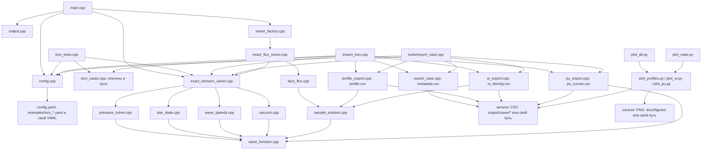

# Модули части 1 и их зависимости

На стрелке `A → B` компонент `A` обращается к `B`: вызывает функцию, читает входной файл или записывает результат. Стрелки направлены от управляющего уровня к вычислительному; циклов между модулями нет. Данные из `config.yaml` попадают в решатель только через аргументы функций.

## Зачем нужны отдельные модули

| Модуль | Задача | Почему зависит именно от этих модулей |
| --- | --- | --- |
| `config` | Читает проверенное подмножество YAML, возвращает `Config`. | Не зависит от численного решателя; смена формата входа не меняет формулы §15. |
| `wave_function` | Считает скорость звука, функцию волны `f(p, W)` и производную по §15. | Это общий низкоуровневый расчёт для Ньютона, звёздных состояний и кривых `p–u`. |
| `vacuum` | Проверяет условие (15.15). | Нужны только скорости звука исходных состояний. Вызывается до Ньютона. |
| `pressure_solver` | Выбирает GUESSP и решает уравнение (15.13) методом Ньютона. | Использует `wave_function`; не знает о сетке или выводе. |
| `star_state` | Находит `u_star`, `rho_star_left`, `rho_star_right`. | Использует найденное давление и те же функции волн. |
| `wave_speeds` | Определяет типы и скорости двух волн. | Использует исходные состояния, `StarState` и скорости звука. |
| `exact_riemann_solver` | Последовательно собирает проверку вакуума, давление, состояния и скорости в `RiemannResult`. | Это единая точка вызова точного решателя для тестов и экспорта. |
| `sample_solution` | Возвращает `W(S)` по §15.9. | Получает готовый результат и работает без файлов, сетки и графиков. |
| `face_flux` | Берёт `W(0)` и считает три компоненты потока (15.23). | Опирается на `sample_solution`; подходит будущей схеме Годунова. |
| `riemann_flux_solver`, `exact_flux_solver`, `solver_factory` | Общий интерфейс потока и выбор реализации по имени. | Будущая схема вызывает интерфейс, а не конкретный точный решатель. Новый решатель можно добавить отдельной реализацией. |
| `toro_cases`, `toro_tests` | Хранят эталоны из PDF и проверяют пять задач. | Начальные состояния остаются в YAML, эталоны отделены от расчётного кода. |
| `profile_export`, `xt_export`, `pu_export`, `export_case` | Записывают числовые CSV и метаданные. | Пользуются решением, но не рисуют. Каждый вид данных имеет свой `.hpp` и `.cpp`. |
| `plot_*.py` | Строят PNG из CSV. | Не вызывают численный решатель. Графики можно перестроить без повторного расчёта, если данные уже сохранены. |
| `tools/export_case.cpp`, `scripts/plot_case.py` | Управляют экспортом и отрисовкой произвольной задачи из своего YAML. | Переиспользуют те же функции записи CSV и построения PNG, что и пять тестов Торо. |

Все функции расчётной библиотеки получают параметры явно и не имеют общего изменяемого состояния. Это позволяет позже вычислять потоки на разных гранях независимо. Сетку, фиктивные ячейки, граничные условия, шаг по CFL и обмен между MPI-процессами можно добавить над интерфейсом `RiemannFluxSolver`, не переписывая формулы точного решателя. Конкретная архитектура полного комплекса и распределение работы группы относятся к части 2 задания.
